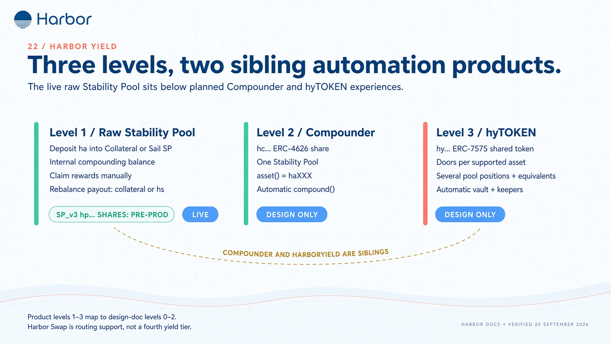

# Harbor Yield

:::caution Not live on mainnet
**Levels 2–3** (Compounder and **hyTOKEN**) are **mid-term** products, not live mainnet UX yet. **Level 1** (stability pools in [**Earn**](https://app.harborfinance.io/anchor)) **is live**. See [Roadmap](/roadmap).
:::

**Harbor Yield** is Harbor’s planned yield stack on top of stability pools, three participation **levels** from manual control up to a single pooled **hy** token per peg.

Work lives in [`baofinance/harbor-yield`](https://github.com/baofinance/harbor-yield). For contract details, see [Tech docs, Harbor Yield](/tech-docs/contracts/harbor-yield) and [Build on Harbor](/tech-docs/integrators).

## Three participation levels

You need **ha** to use a stability pool. **hs** is not a pool deposit asset.

Both pool types earn **concentrated collateral yield** on **ha** deposits. They differ on **rebalance payout**: collateral pool → **collateral**; Sail pool → **hs**. See [Stability Pools](/stability-pools) and [How Yield is Generated](/yield).

| Level | What you do | Tokens | Claiming |
| ----- | ----------- | ------ | -------- |
| **1** | Mint **ha** / **hs**, deposit **ha** into a stability pool ([**Earn**](https://app.harborfinance.io/anchor)), claim yourself | **ha** earning pool yield | Manual |
| **2** | Deposit **ha** into that pool’s **Compounder** | **hc…** shares over **one** pool | Automatic |
| **3** | Deposit via a **hy** vault door → receive **hy…** | **hy…** (e.g. hyETH), peg basket share | Automatic (vault) |

- **Level 1** is **live** on Ethereum mainnet.
- **Compounders (level 2) and hy (level 3) are siblings**, not a stack. One pool + auto-compound → Compounder. Diversified peg yield → **hy**. Neither wraps the other.
- Each market has **two** Compounders: one over the collateral pool, one over the Sail pool. **hy** holds the collateral-pool side. The Sail Compounder stays a level-2 product on its own.

## Why it exists

Today (level 1):

1. Hold **ha** (and optionally **hs**)
2. Deposit **ha** into a collateral or Sail stability pool
3. Claim rewards and decide what to do with them. On rebalance, receive **collateral** or **hs** depending on pool

Harbor Yield adds:

- **Level 2 (Compounder)**: automatic compounding over one pool, collateral or Sail
- **Level 3 (hyTOKEN)**: one share per peg over collateral-pool positions and peg-equivalent vaults

[Harbor Swap](/tech-docs/contracts/harbor-swap) is routing support for **hy** vaults, not a separate yield tier.

## How the stack fits together

| Layer | Role |
| ----- | ---- |
| **Stability pools** | Live base, **ha** deposits earn concentrated yield; rebalance pays collateral vs **hs** |
| **Compounders** | Per-pool auto-compound product (**level 2**) |
| **hyTOKEN** | Optional peg basket (**level 3**) |
| **Harbor Swap** | Routes rewards between basket legs when **hy** vaults need DEX paths |

## Level 1 - Stability pools (live)

Mint **ha** and/or **hs**. Deposit **only ha** into [**Earn**](https://app.harborfinance.io/anchor), then claim when you want.

See [Stability Pools](/stability-pools).

## Level 2 - Compounder (mid-term)

Each market deploys two Compounders from the same contract (`Compounder_v1`). Each wraps **one** stability pool. Depositors hold **hc…** shares. Keepers (usually the stability pool manager, on every harvest and rebalance) or users call `compound()`, which turns pending wrapped collateral into more of that pool.

| Pool | Share | What `compound()` rolls in |
| ---- | ----- | -------------------------- |
| Collateral | **hcXXX.COLn** | Harvest and rebalance wrapped collateral, minted back to **ha** and redeposited |
| Sail | **hcXXX.hsCOLn** | Harvest wrapped collateral. **hs** paid on rebalance stays claimable with `claim()` |

**hy** holds collateral-pool positions. Sail-pool auto-compound stays on **hcXXX.hsCOLn**.

**For builders:** [Harbor Yield contracts](/tech-docs/contracts/harbor-yield).

## Level 3 - hyTOKEN (mid-term)

One **hy** share per peg (e.g. hyETH) over **collateral-pool** positions plus peg-equivalent vaults. Enter/exit through vault **doors** (product UX, not live app yet). Sail-pool exposure stays on the Sail Compounder at level 2.

**For builders:** [hy / ERC-7575](/tech-docs/integrators/hy-erc7575) · [Harbor Swap](/tech-docs/contracts/harbor-swap).

## What users get

| Preference | Level | Use |
| ---------- | ----- | --- |
| Max control | **1** | [**Earn**](https://app.harborfinance.io/anchor), deposit **ha**, claim yourself |
| Auto-compound one pool | **2** | Compounder (when shipped) |
| Simple “earn on this peg” | **3** | **hy** basket (when shipped) |

## Relationship to other yield

- **Yield concentration**: **ha** in pools earns from full collateral backing. See [How Yield is Generated](/yield)
- **Protocol revenue**: Yield Share first, then 75% pools / 25% buy TIDE. See [TIDE Tokenomics](/tide-token/tokenomics)
- **Maiden Voyage Yield Share**: [Maiden Voyage](/maiden-voyage)

Harbor Yield adds **convenience and pooling** on top; it does not replace those economics.

## Status

- Implemented in [`baofinance/harbor-yield`](https://github.com/baofinance/harbor-yield); **mid-term** mainnet rollout
- Watch [app.harborfinance.io](https://app.harborfinance.io) and this site for launch announcements
