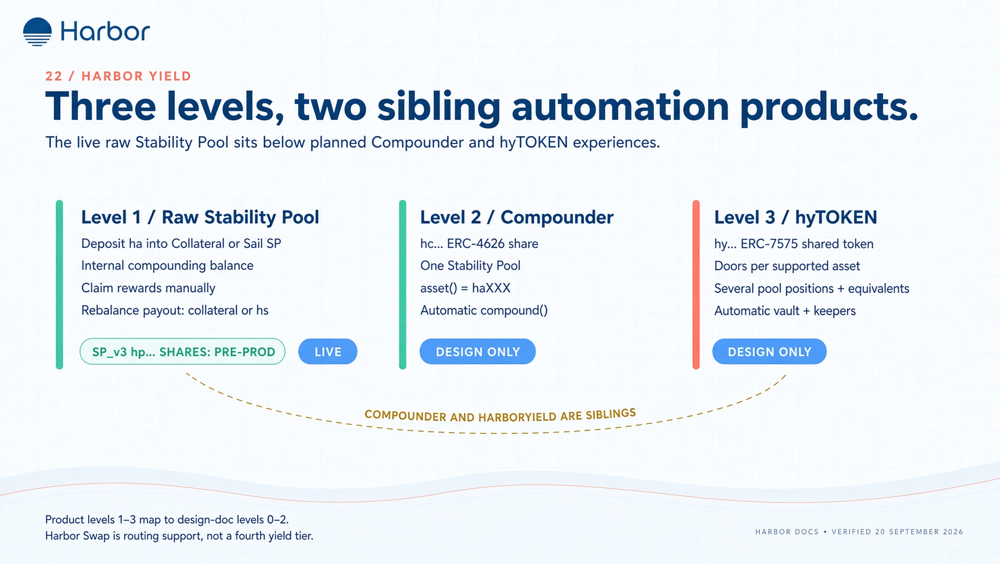

# Harbor Yield

> **Status**: In progress (not live mainnet UX)  
> **Repos**: [`baofinance/harbor-yield`](https://github.com/baofinance/harbor-yield) (+ foundation on [harbor PR #33](https://github.com/baofinance/harbor/pull/33))  
> **Product overview**: [Harbor Yield (hyTOKENS)](/harbor-yield)  
> **Integrator standards**: [hy / ERC-7575](../integrators/hy-erc7575.md)

Harbor Yield is the mid-term yield stack on top of stability pools. Product framing uses **three participation levels**; this page tracks the **contract surface**. Authoritative design: [`doc/design.md`](https://github.com/baofinance/harbor-yield/blob/multi-asset/doc/design.md) on branch `multi-asset` (checked 2 Nov 2026, `1e9ce4c`). `main` on that repo is an older scaffold. Integrations: [`doc/integrations.md`](https://github.com/baofinance/harbor-yield/blob/multi-asset/doc/integrations.md).

## Deposit and rebalance rules (shared with product)

These rules apply at every level that touches a stability pool (or its Compounder):

| Rule | Detail |
| ---- | ------ |
| **Mint / acquire** | Users can mint **haTokens** and/or **hsTokens**, or acquire them via a market |
| **Pool deposit (live mainnet v1/v2)** | **Only haTokens** into the collateral or Sail pool → compounding **internal balance** (no ERC-20 pool share) |
| **Pool deposit (SP_v3 / pre-prod)** | Same ha-only rule; receive rebasing **hp…** ERC-20 shares — **not** live UX yet |
| **Compounder deposit** | ERC-4626 `deposit()` takes **haXXX** (`asset()` = pegged token). Optional `depositStabilityPool` wraps an existing pool position — **pre-prod** |
| **Pool yield** | **Both** pools accrue concentrated collateral yield / harvest + revenue share on haToken deposits |
| **Rebalance payout** | Collateral pool → **wrapped collateral** (e.g. fxSAVE / wstETH); Sail pool → **hsTokens** (deposited haTokens are burned). **hsTokens** do not earn concentrated yield on their own |

Product UX: [Harbor Yield](/harbor-yield). Live pool behaviour: [Stability pool](./stability-pool.md).

## Three participation levels

This docs site uses **product-facing Levels 1–3**. The design doc numbers the same stack **0–2**. Mapping:

| Product (this site) | Design doc | Component |
| ------------------- | ---------- | --------- |
| **Level 1** | **Level 0** | Raw stability pool |
| **Level 2** | **Level 1** | Compounder (`Compounder_v1`, **hc…**) — **ERC-4626** |
| **Level 3** | **Level 2** | HarborYield / **hyTOKEN** — **ERC-7575** share + doors |

| Level | User flow | Contracts / shares |
| ----- | --------- | ------------------ |
| **1** | Mint/buy ha/hs → deposit **haTokens** into collateral or Sail **stability pool** → claim rewards yourself | Live: SP **v1/v2** compounding balances. **SP_v3** `hp…` shares = yield branch only |
| **2** | Deposit **haXXX** via ERC-4626 → **hc…** | `Compounder_v1` per pool |
| **3** | Deposit via **ERC-7575 door** (wrappedCollateral or equivalent asset) → **hyXXX** | `HarborYield_v1` + `HarborYieldEntry_v1` |

- **Level 1** (stability pools) is live on **Ethereum mainnet**. Levels **2** and **3** ship with Harbor Yield.
- **Compounder and HarborYield are siblings**. Neither holds the other. HY holds **collateral-pool** positions directly, plus peg-equivalent ERC-4626 vaults.
- One `Compounder_v1` serves both pool kinds. Deploy ships two per market: collateral share **hcXXX.COLn** and Sail share **hcXXX.hsCOLn**. The Sail Compounder stays at level 2. HY does not register it (design doc §6.4).

## Layer model (contracts)

| Level | Component | Share / asset | Role |
| ----- | --------- | ------------- | ---- |
| **1** | Stability pools (live **v1/v2**; → **v3** on yield branch) | Live: compounding balances. **hp…** ERC-20 shares = **v3-only / pre-prod** | Base yield / rebalance; manual claim |
| **2** | Compounder | Non-rebasing ERC-4626 **hc…**; `asset` = **haXXX** | Usable per-pool compounding |
| **3** | HarborYield | **ERC-7575** share **hy…** + per-holding doors | Multi-holding basket; doors reuse ERC-4626 mutations without a separate door ERC-20 |
| — | Harbor Swap | — | Routing support for level 3 (`compound` / `redistribute`), not a yield tier |

## Foundation contracts (`harbor` yield branch)

PR [#33](https://github.com/baofinance/harbor/pull/33) widens the **data envelope** and adds yield-facing hooks on the core stack:

| Contract | Version on branch | Notes |
| -------- | ----------------- | ----- |
| **StabilityPool** | **v3** | ERC-20 pool shares (Solady + EIP-2612); floor clamps; clamp-then-fee withdrawals; still **haToken** deposits. Views drop the `get` prefix: `earlyWithdrawalFeeRatio()`, `withdrawalWindow()`, `feeReceiver()`. Live v2 keeps `getEarlyWithdrawalFee()` / `getWithdrawalWindow()` |
| **StabilityPoolManager** | **v2** | Calls `IYieldVault.compound()` after harvest and rebalance. Branch config: rebalance bounty **0.5%** and cut **0.5%**, ceiling 200× `aboutADollar`; harvest bounty **0.5%**, cut **99.5%**. Live v1 is bounty-only at **1%** |
| **Minter** | **v3** | `MAX_LEVERAGE_RATIO = 100` (minimum CR ≈ **101.01%**). A Sail-leg redeem below that floor reverts. Live `Minter_v2` cap stays **20×** at ≈ **105.3%** |

### Upgrade path (mainnet)

| Field | Value |
| ----- | ----- |
| **Scripts** | `script/Upgrade_MarketsToV3_mainnet.s.sol`, `script/UpgradeStabilityPool_v2_v3/` |
| **State** | Continues to use BaoFactory CREATE3 + `harbor_v1.state.json` patterns |
| **Live status** | Treat as **pre-production** until upgrades are executed |

## Level 2 / 3 product contracts (`harbor-yield`)

| Contract | Standard | Role |
| -------- | -------- | ---- |
| **`Compounder_v1`** | **ERC-4626** | One pool per deployment (collateral or Sail). `compound()` converts pending wrapped collateral into more of that pool. Extra rewards, including **hs** on a Sail pool, stay on `claim()` |
| **`HarborYield_v1`** | **ERC-7575 share** (+ ERC-20) | Peg basket; holds pools **directly** + equivalent vaults; `vault(asset)`, `redeemProportional`, `compound` |
| **`HarborYieldEntry_v1`** | **ERC-7575 vault** (ERC-4626 minus ERC-20) | One door per holding; `share()` → hyXXX; door `asset` = wrappedCollateral or equivalent asset |
| **`WstETH_ERC4626_v1`** | ERC-4626 adapter | Thin wrap so non-vault yield sources can be HY holdings |

| Field | Value |
| ----- | ----- |
| **Collateral Compounder `compound()`** | Claims **wCOLn** (harvest and rebalance) → mint **ha** when the fee cap allows → redeposit |
| **Sail Compounder `compound()`** | Same function, harvest **wCOLn** only. **hs** rebalance receipts stay per-holder and are taken with `claim()` |
| **HY `compound()`** | Prices destinations it can read, end to end (swap + take); cheapest wins; water-fills. An unpriceable source pool sits the pass out with its yield still claimable. An unpriceable destination drops out of the round (`1e9ce4c`) |
| **hy entry/exit** | ERC-7575 doors — **not** a single ERC-4626 `asset()` on hyXXX |
| **Harbor Swap use** | Direct routes on the hot path (`minAmountOut`, whole order). Velora (primary, on `harbor-swap` `main`) / 1inch (optional) on `redistribute` |
| **Early-withdrawal fee (branch config)** | `ConfigStabilityPool` returns **5%** (`5e16`), 1 hour delay, 25 hour window. Live `main` config is **1%**. The v3 upgrade applies the branch figure |

Deploy phasing still tracks Swap’s consumer/yield vault phase after Minter_v3 / SP_v3 / oracles / swap registry.

## See also

| Resource | Use for |
| -------- | ------- |
| [Harbor Yield (product)](/harbor-yield) | Three levels, UX |
| [hy / ERC-7575](../integrators/hy-erc7575.md) | Integrator standards surface |
| [Harbor Swap](/tech-docs/contracts/harbor-swap) | Registry, DEX executors, Velora |
| [Stability pool](./stability-pool.md) | Live v1/v2 pool behaviour (level 1) |
| [Coverage audit](../coverage.md) | PR / branch checklist |
| [Zap contracts](./zap.md) | Separate Maiden Voyage convenience (not HY) |
