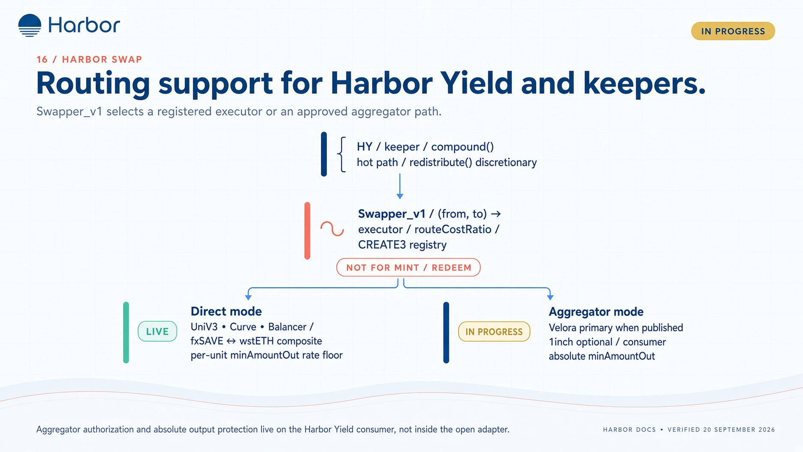

# Harbor Swap

Harbor Swap is a **token routing** registry (direct DEX executors + optional aggregators). It does **not** mint ha/hs and does **not** change yield math.

Use it when a Harbor Yield vault or keeper needs to move one asset to another (e.g. fxSAVE ↔ wstETH). For mint/redeem, use the [minter](./mint-redeem.md) (or [zaps](./zaps.md)).

Contract SoT: [Harbor Swap](/tech-docs/contracts/harbor-swap). Yield consumer: [hy / ERC-7575](./hy-erc7575.md) (pre-prod).

:::info Production status
Registry, direct executors, and **Velora** (primary aggregator) are on `harbor-swap` `main` ([#3](https://github.com/baofinance/harbor-swap/pull/3) merged 28 Sep 2026). Do not assume a mainnet swapper address until it is listed on a market / yield deploy page.
:::

## Two modes

| Mode | Caller | Slippage / floor |
| ---- | ------ | ---------------- |
| **Direct** | Hot path (`compound` on HarborYield) | `swap(..., minAmountOut)` — whole-order floor in `toToken` units, pro-rated by input spent |
| **Aggregator** | Discretionary (`redistribute`) | Same whole-order `minAmountOut`; keeper supplies `routerData`; **role-gated on the consumer** |

Adapters are callable. Safety is the consumer role, that whole-order floor, and the executor envelope (unspent input is refunded; `amountOut == 0` reverts). `0` disables the floor. Selector allowlists do not validate swap parameters. The published `@harbor/sdk` helper still encodes the older `minAmountOutPerUnitIn` rate argument — see [SDK](./sdk.md).

## What to integrate (when addresses exist)

1. Resolve `swapper` (CREATE3 key `swapper`) — do not hard-code; predict via Harbor deploy helpers.  
2. Direct: `getRoute(from, to)` then executor `swap` with a real whole-order `minAmountOut`.  
3. Aggregator: Velora Market API (`GET /prices`, `POST /transactions/:chainId`) with `userAddress` = adapter proxy; optional 1inch Pathfinder; set an absolute output floor on the Yield call.  
4. Treat `routerData` as untrusted.

CREATE3 keys and Velora/1inch notes: [Harbor Swap](../contracts/harbor-swap.md).

## Not for

- Quoting ha/hs mint or redeem (use minter dry-runs)  
- Reading Harbor oracle prices (use [Pricing](./pricing.md))  
- Generic DEX aggregation for your own users unless you are the Harbor Yield keeper path

## Related

- [Harbor Yield contracts](../contracts/harbor-yield.md)
